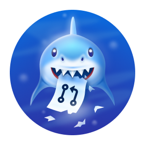

<!--  -->

<div align="center">
  
</div>

<br/>

<div align="center">
<a href="https://github.com/Madankk-06?tab=followers">
  
</a>
<br/>
  
---

## 🧑‍💻 About Me
<div align="left">

```python
class MadanKK:
    def __init__(self):
        self.name         = "Madan K.K"
        self.location     = "Coimbatore, Tamil Nadu, India 🇮🇳"
        self.degree       = "MCA – Generative AI @ Alliance University"
        self.portfolio    = "https://madankk.is-a.dev"
        self.email        = "madankk2004@gmail.com"
        self.stack        = [
            "Python", "JavaScript", "Java", "C++",
            "React.js", "Node.js", "MongoDB", "MySQL",
            "Firebase", "Supabase", "AWS", "Figma"
        ]
        self.learning     = [
            "Quantum Computing",
            "Advanced Prompt Engineering",
            "Cyber Security",
            "Generative AI Systems"
        ]
        self.hobbies      = ["Travelling ✈️", "Drawing 🎨"]
        self.languages    = ["English", "Tamil", "Hindi"]
        self.fun_fact     = "I once optimised a route algorithm so well, even Google Maps got jealous 🗺️"

    def motto(self) -> str:
        return "Build smart. Design clean. Think AI. 🚀"

me = MadanKK()
print(me.motto())
```
</div>
<div align="center">
  
</div>


## 📊 GitHub Stats

<div align="center">
  <!--  -->
  &nbsp;
  
  <br/><br/>
  
</div>

---


## 🎖️ GitHub Achievement Badges

<div align="center">
<a href="https://github.com/Madankk-06?tab=achievements">
  
  
  
</a>
</div>
---


## 🌐 Connect With Me

<div align="center">

[](https://madankk.is-a.dev)
[](https://linkedin.com/in/madankk04122004)
[](https://github.com/Madankk-06)
[](https://leetcode.com/u/madankk-04122004/)
[](https://hackerrank.com/profile/madankk2004)
[](mailto:madankk2004@gmail.com)

</div>

---

<div align="center">
  
  # <b>"I SPEAK IN DATA AND THINK LIKE AI"</b>
  
</div>


